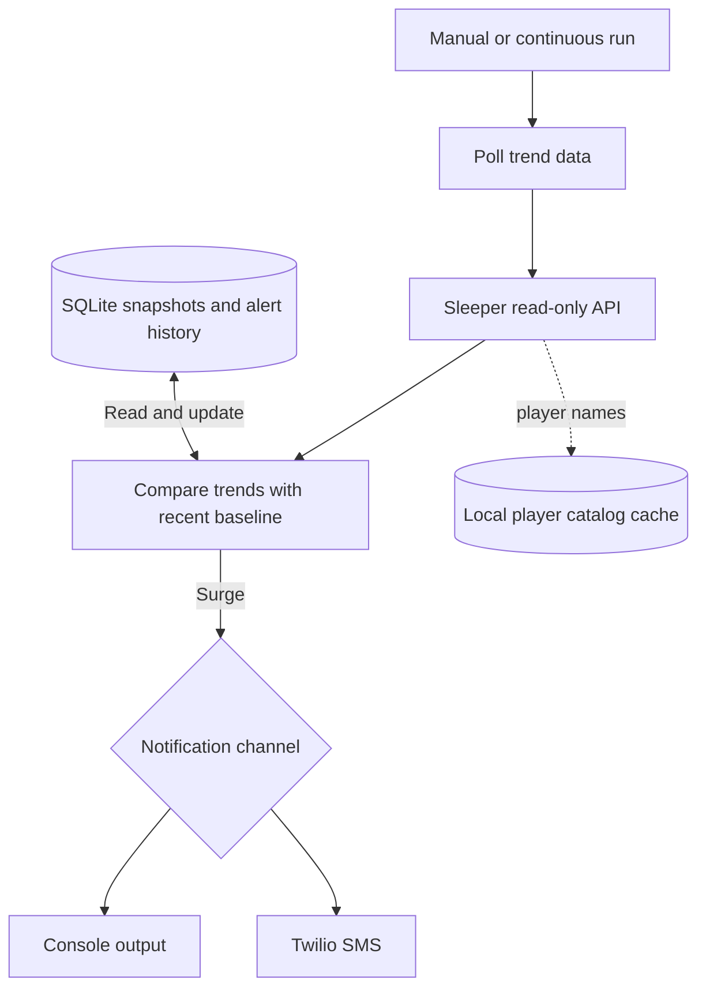

# Architecture

The service periodically checks Sleeper's add/drop trends, compares current activity with each
player's recent baseline, and sends an alert when configured surge rules are met. Settings control
the polling interval, trend windows, thresholds, cooldown, and notification destination.

## Main parts

- The CLI starts a one-time poll, displays current movers, or runs continuously.
- The Sleeper client fetches trend data and caches the player catalog locally for readable alerts.
- The detector scores players and applies surge, cooldown, and escalation rules.
- SQLite keeps recent poll snapshots and alert history between runs.
- The notifier prints alerts or sends them through Twilio when credentials are configured.

## Local state

Runtime data lives under `data/`: `trending.db` stores snapshots and alert history, and
`players.json` caches player details. Snapshots are kept for seven days; alert history is retained
to support cooldown decisions.
